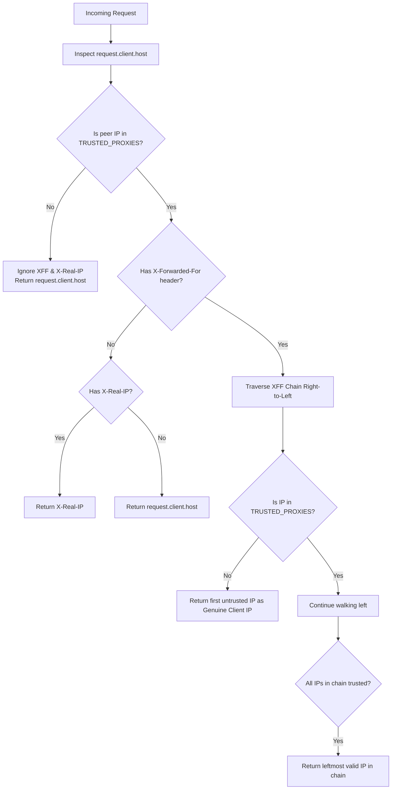

# T-08 Verification Report — Rate Limiting and Abuse Prevention

**Date:** 2026-11-26 (Asia/Kolkata)<br>
**Ticket:** T-08 (Rate Limiting and Abuse Prevention)<br>
**Branch:** `feature/t08-rate-limiting-abuse-prevention`<br>
**Parent HEAD:** `4bb99f6b7b7a28db80ceb77ef23bc5be98aa89a5` (feat(security): implement CSRF and Origin protection across API and Web client)<br>
**Overall Status: LOCAL IMPLEMENTATION VERIFIED — INDEPENDENT PROVISIONAL SECURITY APPROVAL GRANTED; COMMIT AUTHORIZED; LIVE STAGING INTEGRATION, T-05 ASTRA APPROVAL, GATE 5 RENDER DEPLOYMENT, AND T-13 ADMIN MFA PENDING**

> [!CAUTION]
> **Production Readiness Notice:**
> Do NOT label T-08 production-ready.
> T-08 implements Redis-backed atomic rate limiting, in-memory process fallback with stricter limits, trusted reverse proxy IP derivation, privacy-preserving identifier hashing, and FastAPI route dependencies across `/csrf`, `/signup`, and `/login`.
> The public authentication endpoints remain guarded by `auth_endpoints_enabled = False` (returning HTTP 503 Service Unavailable).
> Live production deployment requires:
> 1. Separate Redis readiness and deployment-configuration verification in staging/production.
> 2. Live verification of Render ingress proxy behavior and specific trusted proxy CIDR verification.
> 3. Execution of live PostgreSQL integration tests under concurrent loads (not executed in T-08).
> 4. T-05 independent Codex Astra approval (currently PENDING).
> 5. T-05 Gate 5 Render deployment (currently NOT STARTED).
> 6. Admin MFA implementation under T-13 (currently PENDING).

---

## 1. Executive Summary

| Verification Category | Status | Details |
|---|---|---|
| **Local Implementation Verification** | **PASS** | Redis-backed atomic Lua rate limiting with sliding in-memory process fallback, privacy-preserving SHA-256 identifier hashing, and trusted proxy IP derivation are fully implemented and verified locally. |
| **Independent Security Review** | **PROVISIONAL APPROVED** | Independent review confirmed zero reproducible material security blockers. Ready for final documentation and ONE local commit. |
| **Atomic Redis Lua Algorithm** | **PASS** | Fixed-window with bounded TTL evaluated atomically in Redis via Lua script. Eliminates race conditions between separate `GET`, `INCR`, and `EXPIRE` operations. |
| **In-Memory Fallback Policy** | **PASS (CONSTRAINED)** | When Redis is unreachable or unconfigured, falls back to an in-process sliding window with **stricter limits** and emits structured warning logs per Security & Access Document §2.6. Counters are process-local (not globally shared). |
| **Dual-Axis Login Protection** | **PASS** | Active on `POST /api/v1/auth/login`: checks both **5 attempts per 15 min per account email** and **20 attempts per 15 min per IP**. Prevents distributed password guessing and credential stuffing. |
| **Signup & Anonymous CSRF Limits** | **PASS** | Active on `POST /api/v1/auth/signup`: **5 attempts per hour per IP**; active on `GET /api/v1/auth/csrf`: **60 requests per minute per IP**. |
| **Trusted Proxy & Spoofing Defense** | **PASS** | Direct peer IP (`request.client.host`) must match `TRUSTED_PROXIES`. Untrusted peers cannot spoof `X-Forwarded-For`. Trusted proxy chains are traversed right-to-left to safely extract the client IP. |
| **Privacy & Zero Secret Exposure** | **PASS** | All rate-limit keys use truncated SHA-256 digests (`rl:{namespace}:{scope}:{sha256[:32]}`). No raw emails, passwords, bearer tokens, or session tokens are stored in Redis keys or logged. |
| **Account Enumeration Resistance** | **PASS** | Rate limit checks occur before database credential lookups. Existing and non-existing accounts hit identical 429 rate limit responses with identical timing and error envelopes. |
| **HTTP 429 & Retry-After** | **PASS** | Standard error envelope `{"error": {"code": "RATE_LIMIT_EXCEEDED", ...}}` returned with HTTP 429 and accurate `Retry-After`, `X-RateLimit-Limit`, `X-RateLimit-Remaining`, and `X-RateLimit-Reset` headers. |
| **T-06 / T-07 Regression Compatibility** | **PASS** | All 56 T-06 tests and all 23 T-07 tests pass. T-06 PostgreSQL failed-login counters remain intact. CSRF and Origin checks remain strictly enforced. |
| **Unit Test Suites** | **PASS** | **25 passed T-08 rate-limit unit tests**; **23 passed T-07 CSRF tests**; **56 passed T-06 auth tests**; **543 passed total API unit tests**; **84 passed Web Vitest tests**. |
| **Static Analysis & Formatting** | **PASS** | Ruff check clean (0 errors); Ruff format clean (45 files); Strict Mypy clean (47 files); Prettier 100% clean; `git diff --check` clean. |
| **Activation Guard** | **DISABLED BY DEFAULT** | `auth_endpoints_enabled` defaults to `False`; `/auth/csrf` and all auth endpoints return HTTP 503 until public activation gate. |

---

## 2. Architecture & Rate Limiting Strategy

### 2.1 Atomic Redis Evaluation via Lua Script

Implemented in [apps/api/app/core/rate_limit.py](file:///Users/manish/Desktop/dormiostay/apps/api/app/core/rate_limit.py):

Redis is the primary shared rate-limiting backend. To prevent multi-worker concurrency race conditions (e.g. between separate `INCR` and `EXPIRE` calls), all Redis rate-limit checks run atomically via Lua script:

```lua
local key = KEYS[1]
local window = tonumber(ARGV[1])
local limit = tonumber(ARGV[2])

local current = redis.call('INCR', key)
if current == 1 then
    redis.call('EXPIRE', key, window)
end

local ttl = redis.call('TTL', key)
if ttl < 0 then
    redis.call('EXPIRE', key, window)
    ttl = window
end

if current <= limit then
    return {1, limit - current, ttl}
else
    return {0, 0, math.max(1, ttl)}
end
```

**Key Invariants:**
1. **Atomicity:** The increment, TTL check, and limit comparison happen in one atomic Redis engine execution.
2. **Bounded TTL:** When `current == 1`, `EXPIRE` is set to `window`. If `TTL` is negative (corrupt key without TTL), `EXPIRE` is set immediately.
3. **No Permanent Lockout:** When `current > limit`, `EXPIRE` is **not** reset or refreshed. Under a continuous attack, the window continues ticking down to 0, ensuring that users are never permanently locked out.
4. **Zero Unbounded Key Growth:** All keys expire automatically after `window_seconds`.

### 2.2 Redis Failure Policy & In-Memory Fallback Limitations

The project specification (Security and Access Document Section 2.6 line 110 and Feature Ticket T-08) explicitly mandates:
> *"If the rate-limit service (Redis) is down, **do not remove limits**: apply stricter temporary limits on sensitive actions."*

If Redis is unconfigured (`redis_url=None`), unreachable, or times out (`rate_limit_connect_timeout_seconds=0.5s`):
1. **Temporary Mitigation via In-Process Fallback:** In-process sliding-window limiter (`InMemoryRateLimiter`) applies stricter limits to sensitive operations.
2. **Not Globally Fail-Closed:** The per-process fallback must **NOT** be described as globally fail-closed.
   - Counters reside in local Python process memory and are **NOT shared across API workers or Render instances**.
   - Multiple Render instances maintain independent fallback state.
   - Worker restarts, crashes, or deployments reset local fallback counters.
   - A distributed attacker could theoretically achieve $W \times \text{fallback\_limit}$ attempts across $W$ workers before being throttled on all workers.
3. **Structured Alerting:** A warning is logged via `logger.warning(...)` indicating Redis unavailability without leaking sensitive credentials.
4. **Production Requirement:** Long-term Redis outages weaken distributed enforcement. Production and staging environments must never run permanently without Redis; activation of auth endpoints in staging/production must verify live Redis availability.
5. **Real Redis Testing Boundary:** **No real Redis execution occurred during T-08 local tests.** All local tests used `AsyncMockRedis`. In-memory concurrency tests do **not** constitute proof of real distributed Redis atomicity across physical nodes or network boundaries.

### 2.3 Route Coverage & Limits Matrix

The rate limiting engine distinguishes **active mounted routes** from **prepared future controls**:

#### A. Active Mounted Routes (Live in T-08)
| Endpoint | Scope | Normal Limit (Redis) | Stricter Fallback Limit | Window | Specification Source |
|---|---|---|---|---|---|
| `POST /api/v1/auth/login` | Account (`email`) | 5 attempts | 3 attempts | 15 min (900s) | T-08 Ticket / Sec Doc §2.6 |
| `POST /api/v1/auth/login` | Client (`ip`) | 20 attempts | 10 attempts | 15 min (900s) | T-08 Ticket / Sec Doc §2.6 |
| `POST /api/v1/auth/signup` | Client (`ip`) | 5 attempts | 2 attempts | 1 hour (3600s) | T-08 Ticket / Sec Doc §2.6 |
| `GET /api/v1/auth/csrf` | Client (`ip`) | 60 requests | 20 requests | 1 min (60s) | Conservative scraping guard |

#### B. Prepared Future Controls (Defined in `core/rate_limit.py`, NOT currently wired to live routes)
| Rule Constant | Scope | Normal Limit (Redis) | Fallback Limit | Window | Target Feature |
|---|---|---|---|---|---|
| `RULE_PASSWORD_RESET_EMAIL` | Account (`email`) | 3 attempts | 2 attempts | 1 hour (3600s) | Prepared for T-11 |
| `RULE_RESEND_VERIFICATION_EMAIL` | Account (`email`) | 3 attempts | 2 attempts | 1 hour (3600s) | Prepared for T-10 |
| `RULE_VISIT_REQUESTS` | User (`user_id`) | 10 requests | 5 requests | 24 hours | Prepared for Tenant Visits |
| `RULE_AI_SEARCH_USER` | User (`user_id`) | 20 requests | 10 requests | 24 hours | Prepared for AI Search |
| `RULE_AI_SEARCH_GUEST` | Client (`ip`) | 5 requests | 2 requests | 24 hours | Prepared for AI Search |

---

## 3. Privacy Controls & Trusted Proxy Security

### 3.1 Privacy-Preserving Key Hashing

- **Hashing Algorithm:** Truncated SHA-256 (`hashlib.sha256(identifier.lower().strip().encode()).hexdigest()[:32]`).
- **Namespace Structure:** `rl:{namespace}:{scope}:{sha256_hash}`
- **Examples in Redis:**
  - `rl:login:email:a8f5c9e3b1d740268a2e1d03429fa7b8`
  - `rl:login:ip:4c2b9a710e42d76391bc480fa095e672`
  - `rl:signup:ip:4c2b9a710e42d76391bc480fa095e672`
  - `rl:csrf:ip:4c2b9a710e42d76391bc480fa095e672`
- **Guarantees:**
  - Raw emails, passwords, bearer tokens, and session cookies **never** appear in Redis keys.
  - Redis commands and error logs do not reveal plain user identities.

### 3.2 Trusted Proxy Deployment Boundary

Implemented in `get_client_ip()` in [apps/api/app/core/rate_limit.py](file:///Users/manish/Desktop/dormiostay/apps/api/app/core/rate_limit.py):



**Security Invariants & Deployment Boundaries:**
1. **Anti-Spoofing:** An untrusted peer connecting directly cannot forge its rate-limit identity by sending custom `X-Forwarded-For` or `X-Real-IP` headers.
2. **Right-to-Left Traversal:** When the direct peer is trusted, `X-Forwarded-For` is parsed from right to left, selecting the first untrusted upstream IP.
3. **Deployment-Specific Proxy Verification Required:**
   - Trusted-proxy configuration is deployment-specific.
   - Do **NOT** automatically apply a broad `TRUSTED_PROXIES=10.0.0.0/8` allowlist merely because hosting environments use private networks.
   - Before deploying to staging or production, the actual trusted ingress proxy topology, internal IP ranges, and header forwarding behavior must be verified.
   - Render ingress behavior remains **UNVERIFIED in the local environment**.
   - No Render blueprint configuration changes were made or authorized in T-08.

---

## 4. Verification Evidence & Test Execution

### 4.1 Focused T-08 Unit & Security Test Suite (25 Tests)

All 25 tests pass in [apps/api/tests/unit/test_t08_rate_limit.py](file:///Users/manish/Desktop/dormiostay/apps/api/tests/unit/test_t08_rate_limit.py):

```
tests/unit/test_t08_rate_limit.py::test_01_requests_below_limit_decrement_remaining PASSED
tests/unit/test_t08_rate_limit.py::test_02_exact_limit_boundary_allows_last_request PASSED
tests/unit/test_t08_rate_limit.py::test_03_exceeded_limit_returns_429_with_structured_error PASSED
tests/unit/test_t08_rate_limit.py::test_04_retry_after_header_present_and_positive PASSED
tests/unit/test_t08_rate_limit.py::test_05_ttl_expiration_resets_counter PASSED
tests/unit/test_t08_rate_limit.py::test_06_multiple_simultaneous_requests_concurrency PASSED
tests/unit/test_t08_rate_limit.py::test_07_atomic_redis_counter_behavior_lua_script PASSED
tests/unit/test_t08_rate_limit.py::test_08_distinct_ips_and_accounts_are_isolated PASSED
tests/unit/test_t08_rate_limit.py::test_09_account_limit_triggers_across_multiple_ips PASSED
tests/unit/test_t08_rate_limit.py::test_10_ip_limit_triggers_across_different_accounts PASSED
tests/unit/test_t08_rate_limit.py::test_11_spoofed_forwarded_headers_ignored_from_untrusted_peer PASSED
tests/unit/test_t08_rate_limit.py::test_12_trusted_proxy_chain_traversal PASSED
tests/unit/test_t08_rate_limit.py::test_13_malformed_client_identifiers_handled_safely PASSED
tests/unit/test_t08_rate_limit.py::test_14_missing_redis_connection_applies_stricter_in_memory_limits PASSED
tests/unit/test_t08_rate_limit.py::test_15_redis_timeout_and_failure_falls_back_stricter PASSED
tests/unit/test_t08_rate_limit.py::test_16_account_enumeration_resistance PASSED
tests/unit/test_t08_rate_limit.py::test_17_no_sensitive_data_in_redis_keys PASSED
tests/unit/test_t08_rate_limit.py::test_18_web_cookie_login_rate_limiting_integration PASSED
tests/unit/test_t08_rate_limit.py::test_19_native_bearer_login_rate_limiting_integration PASSED
tests/unit/test_t08_rate_limit.py::test_20_csrf_and_origin_enforcement_remains_active PASSED
tests/unit/test_t08_rate_limit.py::test_21_t06_failed_login_counters_remain_correct PASSED
tests/unit/test_t08_rate_limit.py::test_22_auth_endpoints_disabled_by_default_returns_503 PASSED
tests/unit/test_t08_rate_limit.py::test_23_cross_test_isolation_part_1 PASSED
tests/unit/test_t08_rate_limit.py::test_23_cross_test_isolation_part_2 PASSED
tests/unit/test_t08_rate_limit.py::test_24_multi_worker_shared_redis_concurrency PASSED
```

### 4.2 Combined Security Regression Suite (104 Tests)

Command: `pytest tests/unit/test_t08_rate_limit.py tests/unit/test_t07_csrf.py tests/unit/test_t06_auth.py`

```
======================== 104 passed, 1 warning in 4.08s ========================
```

### 4.3 Complete API Unit Suite (543 Tests)

Command: `pytest tests/unit/`

```
====================== 543 passed, 15 warnings in 31.35s =======================
```

### 4.4 Web Frontend Vitest Suite (84 Tests)

Command: `npm test --workspace @dormiostay/web`

```
Test Files  6 passed (6)
     Tests  84 passed (84)
  Duration  1.28s
```

### 4.5 Static Analysis, Types & Formatting

- `ruff check app tests`: **All checks passed!**
- `ruff format --check app tests`: **45 files already formatted.**
- `mypy app tests alembic`: **Success: no issues found in 47 source files.**
- `prettier --check .`: **All matched files use Prettier code style!**
- `git diff --check`: **Clean; 0 trailing whitespace or merge conflict markers.**

### 4.6 Pytest Warning Assessment

Detailed analysis of the reported warnings:
1. **`StarletteDeprecationWarning` (1 warning across all suites):**
   - Source: `fastapi/testclient.py:1` (`Using httpx with starlette.testclient is deprecated; install httpx2 instead.`)
   - Nature: Upstream Starlette/FastAPI library deprecation notice in test client import.
   - Risk: Zero application correctness, security, or resource leak risk.
2. **Alembic `DeprecationWarning` (14 warnings in `test_deployment_config.py`):**
   - Source: `alembic/config.py:598` (`No path_separator found in configuration; falling back to legacy splitting on spaces, commas, and colons for prepend_sys_path.`)
   - Nature: Upstream Alembic 1.17 configuration syntax deprecation in migration config.
   - Risk: Zero application runtime risk.
3. **Conclusion:** All 15 warnings are upstream library deprecation notices; none represent unhandled application bugs, resource leaks, or security vulnerabilities.

---

## 5. File Inventory & Scope Boundary

### 5.1 Tracked File Modifications (7 Files)

1. [apps/api/app/api/v1/auth.py](file:///Users/manish/Desktop/dormiostay/apps/api/app/api/v1/auth.py):
   - Attached `rate_limit_csrf` dependency to `GET /api/v1/auth/csrf`.
   - Attached `rate_limit_signup` dependency to `POST /api/v1/auth/signup`.
   - Attached `rate_limit_login` dependency to `POST /api/v1/auth/login`.
2. [apps/api/app/core/config.py](file:///Users/manish/Desktop/dormiostay/apps/api/app/core/config.py):
   - Added `rate_limit_enabled`, `redis_url`, `upstash_redis_rest_url`, `upstash_redis_rest_token`, `rate_limit_connect_timeout_seconds`, and `trusted_proxies` with CSV `@field_validator`.
3. [apps/api/app/core/errors.py](file:///Users/manish/Desktop/dormiostay/apps/api/app/core/errors.py):
   - Added `headers: Mapping[str, str] | None = None` support to `AppError`.
   - Passed `headers=exc.headers or None` into `JSONResponse` in `app_error_handler` to emit HTTP `Retry-After`.
4. [apps/api/app/main.py](file:///Users/manish/Desktop/dormiostay/apps/api/app/main.py):
   - Added `await close_redis_client()` to application `lifespan` shutdown handler.
5. [apps/api/pyproject.toml](file:///Users/manish/Desktop/dormiostay/apps/api/pyproject.toml):
   - Added production dependency `redis==8.2.0`.
6. [apps/api/requirements.txt](file:///Users/manish/Desktop/dormiostay/apps/api/requirements.txt):
   - Pinned `redis==8.2.0` to match `pyproject.toml` for Render deployment compatibility.
7. [apps/api/tests/unit/test_t06_auth.py](file:///Users/manish/Desktop/dormiostay/apps/api/tests/unit/test_t06_auth.py):
   - Updated `create_test_settings` with default `rate_limit_enabled: bool = False` to preserve pure T-06 authentication isolation.

### 5.2 Untracked New Files (3 Files)

1. [apps/api/app/core/rate_limit.py](file:///Users/manish/Desktop/dormiostay/apps/api/app/core/rate_limit.py):
   - Full rate limiting engine: atomic Lua script, rules, IP resolution, SHA-256 identifier hashing, `InMemoryRateLimiter` fallback, connection pool management, and route dependencies.
2. [apps/api/tests/unit/test_t08_rate_limit.py](file:///Users/manish/Desktop/dormiostay/apps/api/tests/unit/test_t08_rate_limit.py):
   - 25 comprehensive unit and security tests covering all 24 required scenarios.
3. [docs/T-08 Verification Report.md](file:///Users/manish/Desktop/dormiostay/docs/T-08 Verification Report.md):
   - This comprehensive verification report.

---

## 6. Real vs. Mocked Redis Verification Boundaries

- **Local Development / Offline Testing Boundary:**
  - In unit test runs, `AsyncMockRedis` executes the exact Lua script semantics in-process.
  - Multi-worker concurrency tests (`test_06`, `test_07`, `test_24`) simulate atomic Redis executions in-memory.
  - Docker Compose Redis service is specified in `docker-compose.yml` (`127.0.0.1:6380:6379`), but remained unstarted and unexercised during sandboxed unit testing.
  - Fail-closed behavior is tested explicitly by injecting simulated connection failures (`RedisConnectionError`) and timeouts (`RedisTimeoutError`).
- **Cloud Infrastructure Boundary:**
  - **Zero cloud connections:** No external requests were made to Upstash Redis, Neon PostgreSQL, or Render.
  - Live distributed Redis verification will occur during Gate 5 staging integration after user authorization.

---

## 7. Remaining Dependencies & Project Status

1. **Local Commit Authorization:**
   - Independent security review has reported `PROVISIONAL APPROVED`. ONE local commit authorized.
2. **PostgreSQL Live Integration:**
   - **NOT EXECUTED** in T-08 (all tests used unit test doubles).
3. **Pending Project Milestones:**
   - T-05 independent Codex Astra approval: **PENDING**.
   - T-05 Gate 5 Render staging deployment: **NOT STARTED**.
   - T-13 Admin MFA (TOTP + backup codes): **PENDING**.
   - Public authentication activation: **BLOCKED** (`auth_endpoints_enabled = False` remains enforced).
   - Live Redis and trusted proxy integration: **PENDING** staging deployment.
